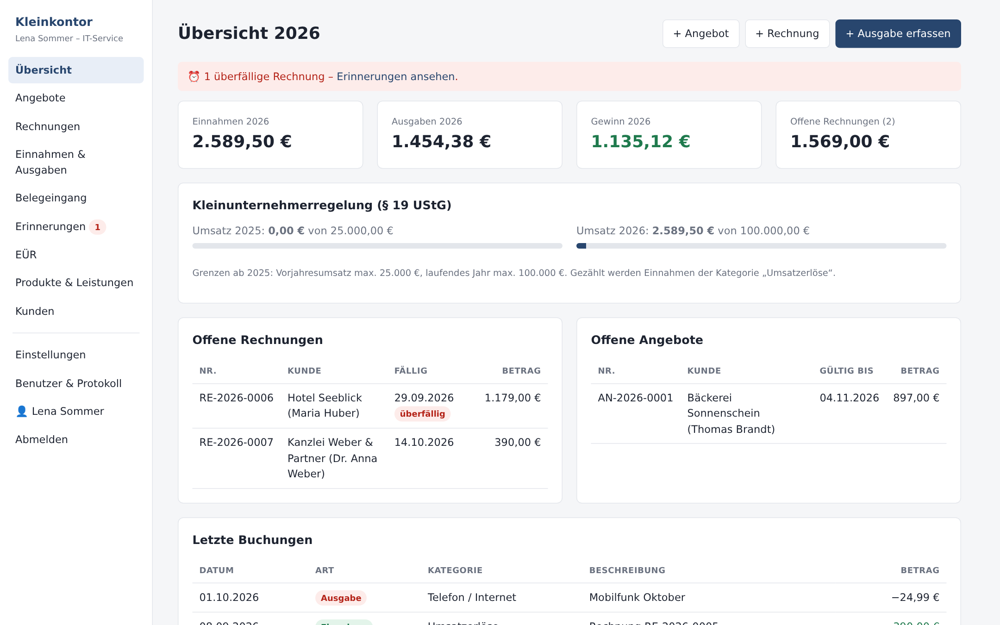
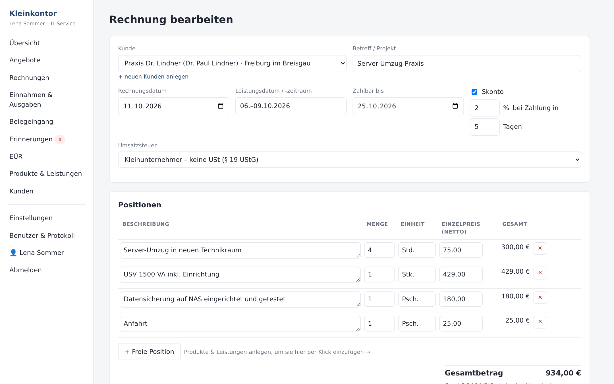
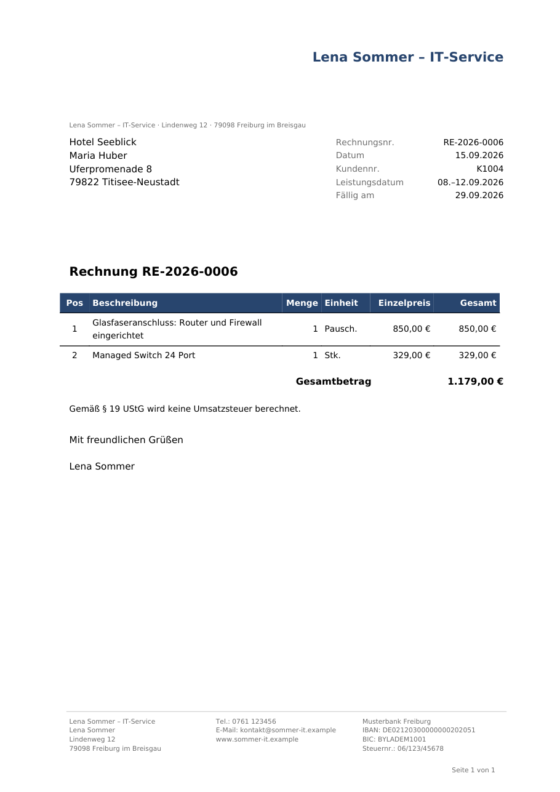

# Kleinkontor

**Buchhaltung für Kleinunternehmer** – schlanke, selbst gehostete Buchhaltung für **Selbständige und Kleinunternehmer in Deutschland**: Angebote, Rechnungen mit **E-Rechnung (ZUGFeRD)**, Einnahmen und Ausgaben, **Einnahmen-Überschuss-Rechnung** mit Ausfüllhilfe für die Anlage EÜR – als Web-App im eigenen Netz, ohne Cloud-Zwang.

> **Haftungsausschluss:** Dieses Programm ist eine Arbeitshilfe und **ersetzt keine Steuerberatung**. Es wird ohne jede Gewährleistung bereitgestellt (siehe [LICENSE](LICENSE), Abschnitte 15 und 16). Für die Richtigkeit von Rechnungen, Buchungen, Steuerangaben und die Einhaltung der GoBD bist du selbst verantwortlich. Steuerliche Regeln (z. B. Zeilen der Anlage EÜR, Umsatzgrenzen) ändern sich regelmäßig – prüfe die Werte vor der Abgabe.

## Funktionen

- **Angebote und Rechnungen** mit fortlaufenden, lückenlosen Nummern, Pflichtangaben nach § 14 UStG, PDF im DIN-5008-Layout mit Logo; Angebot → Rechnung mit einem Klick
- **E-Rechnung:** ZUGFeRD 2.x / Factur-X, Profil EN 16931, als PDF/A-3 mit eingebettetem XML; XML auch einzeln; Käuferreferenz/Leitweg-ID je Kunde
- **GoBD-orientiert:** festgeschriebene Dokumente sind nicht änderbar, Korrektur per Stornorechnung; Protokoll aller wesentlichen Aktionen
- **Kleinunternehmer (§ 19 UStG) oder Regelbesteuerung** (19 %/7 %), umschaltbar; Überwachung der Umsatzgrenzen
- **Skonto** je Rechnung, auf PDF, E-Rechnung und beim Zahlungseingang
- **Einnahmen und Ausgaben** mit EÜR-Kategorien; Zahlungseingang einer Rechnung wird automatisch gebucht (Zuflussprinzip)
- **EÜR-Auswertung** und **Ausfüllhilfe Anlage EÜR** (Zeilen und Kennzahlen der amtlichen Vordrucke 2025 und 2026), CSV-Export
- **Produkte & Leistungen** als Katalog mit Einkaufspreis und Marge
- **Kundenverwaltung**, **E-Mail-Versand** per SMTP mit Vorlagen und Versandprotokoll, **Zahlungserinnerungen** (manuell oder automatisch)
- **Paperless-ngx-Anbindung:** Belege hochladen und verknüpfen, **Belegeingang** mit automatischer Erkennung von Betrag, Datum und Kategorie
- **Benutzer mit Einzelrechten**, Zwei-Faktor-Anmeldung (TOTP), Einladungen und „Passwort vergessen“ per E-Mail
- **Datensicherung** täglich mit Rotation; optional verschlüsselte Kopie auf ein NAS
- Oberfläche auf Deutsch, Hell-/Dunkelmodus, für Handy und Desktop

## So sieht es aus

| Übersicht | Rechnung bearbeiten | Rechnung als PDF |
|---|---|---|
| [](docs/screenshots/uebersicht.png) | [](docs/screenshots/rechnung-bearbeiten.png) | [](docs/screenshots/rechnung-pdf.png) |

<sub>Alle Namen und Daten in den Bildern sind frei erfunden.</sub>

## Schnellstart mit Docker

Fertiges Image: `ghcr.io/chrkraus/kleinkontor` (für amd64 und arm64).

```bash
git clone https://github.com/chrkraus/kleinkontor.git
cd kleinkontor
docker compose up -d
```

Dann <http://localhost:5000> öffnen. **Auf einer Synology-NAS:** siehe [Anleitung für Synology](docs/synology.md). Beim ersten Aufruf legst du das **Admin-Konto** an, danach unter **Einstellungen** Firmendaten, Steuernummer und Bankverbindung. Alle Daten liegen im Ordner `./data` – diesen Ordner unbedingt sichern. Der Container läuft nicht als root, sondern als Besitzer von `./data` (gehört der Ordner root, als uid 1000); mit `PUID`/`PGID` lässt sich der Benutzer festlegen.

## Installation ohne Docker (Linux)

Voraussetzungen: Python 3.11 oder neuer.

```bash
git clone https://github.com/chrkraus/kleinkontor.git
cd kleinkontor
python3 -m venv .venv
.venv/bin/pip install -r requirements.txt
HOST=0.0.0.0 ./run.sh          # Heimnetz; ohne HOST nur auf diesem Rechner erreichbar
```

**Autostart ohne Root** per cron (`crontab -e`):

```
@reboot /pfad/zu/buchhaltung/autostart.sh
*/5 * * * * /pfad/zu/buchhaltung/autostart.sh
```

`autostart.sh` startet die App nur, wenn sie noch nicht läuft, und dient so zugleich als Wächter. Neustart nach Änderungen: `./restart.sh`.

## Konfiguration

Fast alles stellst du in der App unter **Einstellungen** ein (Firma, Steuer, Nummernkreise, Texte, E-Mail-Versand, Paperless, Datensicherung, Erinnerungen). Für den Betrieb gibt es zusätzlich Umgebungsvariablen, die du auch in eine Datei `instance.env` im Programmordner schreiben kannst (wird von den Skripten gelesen, nicht versioniert):

| Variable | Bedeutung | Standard |
|---|---|---|
| `HOST`, `PORT` | Adresse und Port | `127.0.0.1`, `5000` |
| `BUCHHALTUNG_DATA` | Datenordner | `./data` |
| `BUCHHALTUNG_TRUSTED_PROXIES` | weitere Proxy-Adressen, deren `X-Forwarded-*` übernommen werden | nur `127.0.0.1` |
| `NAS_TARGET` | Ziel für `nas_sync.sh`, z. B. `rsync://backup@nas.local/backup/buchhaltung/` | aus |

## Sicher betreiben

- Die App hat eine **eigene Anmeldung** (Passwort, optional Zwei-Faktor, Sperre nach Fehlversuchen). Trotzdem: **nicht direkt ins Internet** stellen. Für den Zugriff von unterwegs eignet sich ein VPN (WireGuard, Tailscale) oder ein Tunnel mit vorgeschalteter Zugangskontrolle (z. B. Cloudflare Tunnel + Access).
- **HTTPS:** einen Reverse-Proxy wie Caddy vorschalten – Vorlage in [`Caddyfile.example`](Caddyfile.example). Die App übernimmt Client-IP und Protokoll nur von vertrauenswürdigen Proxys (`127.0.0.1` bzw. `BUCHHALTUNG_TRUSTED_PROXIES`).
- Hinter HTTPS setzt die App sichere Cookies und HSTS; Formulare von fremden Seiten werden abgewiesen (Origin-Prüfung), dazu eine strenge Content-Security-Policy.
- Passwort vergessen und kein E-Mail-Versand? Auf dem Server: `.venv/bin/python passwort_zuruecksetzen.py <benutzer>`.

## Datensicherung

- Die App sichert sich alle 24 Stunden selbst nach `data/backups/` (ZIP mit Datenbank und Logo, Integritätsprüfung): letzte 30 Tage plus je Monat eine Sicherung für 24 Monate. In den Einstellungen: sofort sichern, herunterladen, zusätzlicher Zielordner.
- **Optional aufs NAS:** `nas_sync.sh` verschlüsselt die Sicherungen (AES-256, Kennwort in `data/backup-verschluesselung.key`) und spiegelt sie per rsync nach `NAS_TARGET` (Passwort in `data/nas-rsync.pass`); täglich per cron aufrufen. Entschlüsseln: `openssl enc -d -aes-256-cbc -pbkdf2 -iter 600000 -in datei.zip.enc -out sicherung.zip`.
- **Wiederherstellen:** App stoppen, `buchhaltung.db` aus der Sicherung nach `data/` kopieren, App starten.
- Bewahre Rechnungen und Belege so lange auf, wie es die Aufbewahrungsfristen (§ 147 AO) verlangen; die App löscht nichts automatisch.

## Paperless-ngx

1. In Paperless unter dem Profil einen **API-Token** erzeugen.
2. In der App unter Einstellungen → Paperless-ngx URL und Token eintragen, „Verbindung testen“.
3. Geschäftsbelege in Paperless mit dem Tag aus den Einstellungen (Standard „Buchhaltung“) versehen – sie erscheinen dann im **Belegeingang** zum Buchen.

## Entwicklung

```bash
.venv/bin/pip install -r requirements.txt -r requirements-dev.txt
.venv/bin/python -m pytest
```

Technik: Python, Flask, SQLAlchemy/SQLite, fpdf2 (PDF), drafthorse (ZUGFeRD), waitress. Geldbeträge werden als ganze Cent gespeichert. Hinweise zur Architektur und zu den fachlichen Regeln: [`docs/ENTWICKLUNG.md`](docs/ENTWICKLUNG.md). E-Rechnungen sollten nach Änderungen zusätzlich mit den offiziellen EN-16931-Regeln bzw. dem Mustang-Validator geprüft werden.

Beiträge sind willkommen – bitte vorher ein Issue eröffnen. Sicherheitslücken bitte vertraulich melden, siehe [SECURITY.md](SECURITY.md).

## Lizenz

[GNU Affero General Public License v3.0](LICENSE). Du darfst das Programm nutzen, verändern und weitergeben; wer eine veränderte Fassung anderen – auch nur über ein Netzwerk – zur Verfügung stellt, muss deren Quelltext unter derselben Lizenz offenlegen. Komponenten Dritter: [THIRD_PARTY.md](THIRD_PARTY.md).

Entwickelt von CK Networks.
